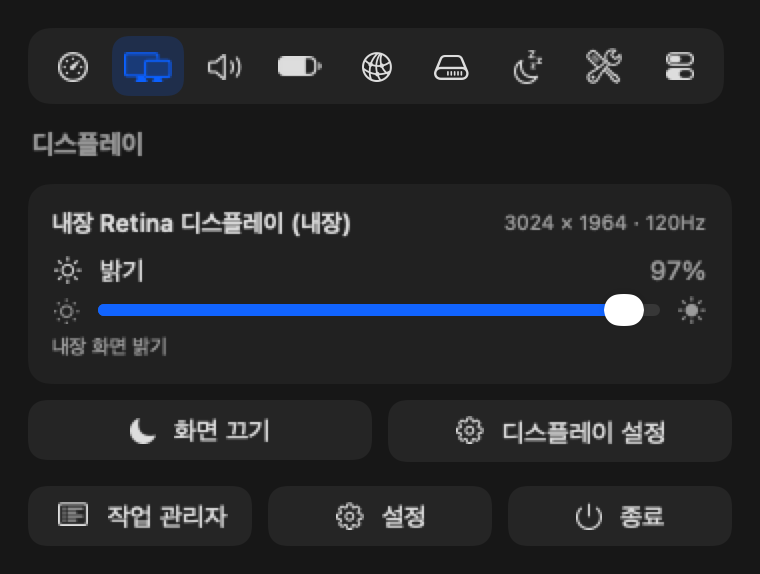
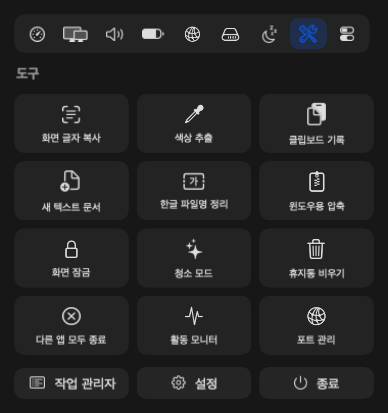
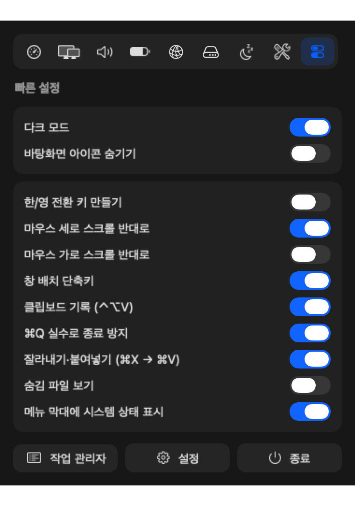

<p align="center">
  
</p>

<h1 align="center">EasyMacKR · 맥편해</h1>

<p align="center">
  한국어 사용자와 윈도우에서 넘어온 사람이 맥에서 불편해하는 것들을 한 번에 고쳐 주는 메뉴 막대 앱<br>
  설치하면 추천 설정이 바로 적용되고, 기능을 끄면 원래 설정으로 돌아갑니다.
</p>

<p align="center">
  macOS 13 이상 · Apple Silicon / Intel · MacBook · iMac · Mac mini · Mac Studio · 무료 · <a href="#라이선스">PolyForm Strict 1.0.0</a>
</p>

---

## 설치

### Homebrew

```sh
brew install --cask macpyeon/tap/macpyeon
```

tap 저장소: [macpyeon/homebrew-tap](https://github.com/macpyeon/homebrew-tap)

업데이트는 `brew upgrade --cask macpyeon`

### 업데이트 알림

새 버전이 나오면 메뉴 막대 **편** 아이콘 오른쪽 위에 점이 찍히고, 패널 맨 위에 바뀐 점과 **업데이트** 버튼이 나옵니다. 누르면 터미널에서 위 brew 명령이 실행돼요. 업데이트 뒤 키보드·마우스 기능이 멈추면 손쉬운 사용 목록에서 맥편해를 한 번 껐다 켜 주세요. (배포판은 개인 인증서로 서명하지 않아서, 버전마다 macOS가 새 앱으로 봅니다)

확인은 12시간마다 GitHub의 최신 릴리스 번호만 받아 오며 내 정보는 보내지 않습니다. 설정 › 일반 › 업데이트에서 끌 수 있어요.

### 직접 빌드

Xcode 또는 Command Line Tools(`xcode-select --install`)가 필요합니다.

```sh
git clone https://github.com/macpyeon/EasyMacKR.git
cd EasyMacKR
./scripts/install.sh
```

### 처음 실행하면

1. 추천 설정이 적용되고 로그인할 때 자동 실행되도록 등록됩니다. (Finder가 한 번 다시 시작됩니다)
2. **시스템 설정 › 개인정보 보호 및 보안 › 손쉬운 사용**에서 **맥편해**를 켜 주세요. 키보드·마우스 기능은 켜는 즉시 동작합니다.
3. 메뉴 막대의 **편** 아이콘을 누르면 간단 패널, 오른쪽 클릭하면 메뉴가 열립니다.

> 직접 빌드할 때 `./scripts/make-signing-cert.sh`를 한 번 실행해 두면 다시 빌드해도 손쉬운 사용 권한이 유지됩니다. (이 Mac 키체인에만 저장되는, 개인정보 없는 인증서)

### 기기별 차이

| 기기 | 차이 |
| --- | --- |
| MacBook | 모든 기능 |
| iMac | 배터리 정보 없음 |
| Mac mini · Mac Studio | 배터리 정보 없음. 외장 모니터 밝기는 DDC 지원 모니터는 모니터 자체 밝기, 미지원 모니터는 화면 덮개로 조절 |
| 외장 키보드 | 매직 키보드의 F2(밝기 키)·지우기 키 그대로 동작. 윈도우용 키보드는 F2·한/영 키 모두 인식 |
| Intel Mac | 온도 표시가 안 될 수 있음. 외장 모니터 DDC 밝기는 Apple Silicon 전용이라 화면 덮개로 대신함 |

---

## 화면

| 디스플레이 | 도구 | 빠른 설정 |
| :---: | :---: | :---: |
|  |  |  |

---

## 기능

### 🇰🇷 한국어

| 기능 | 설명 | 기본 |
| --- | --- | :---: |
| 한/영 전환 키 | 오른쪽 ⌘(또는 ⌥)만 눌렀다 떼면 한/영 전환. 윈도우용 키보드의 한/영 키도 인식 | 켜짐 |
| Caps Lock 즉시 전환 | Caps Lock 한/영 전환 지연·씹힘 제거 | 꺼짐 |
| Esc → 영문 | 한글 입력 중 Esc를 누르면 영문으로 (Vim 사용자용) | 꺼짐 |
| ₩ 대신 \` | 한글 자판에서 \` 키가 백틱을 입력 | 켜짐 |
| 한글 파일명 자소 분리 정리 | 데스크탑·다운로드의 NFD 파일명을 NFC로 바꿔 윈도우·웹에서 `ㅎㅏㄴㄱㅡㄹ`처럼 깨지지 않게 | 켜짐 |
| 윈도우용 압축 | 한국어 윈도우(CP949)·UTF-8 이름으로 압축, `.DS_Store`·`__MACOSX` 제외 (Finder 오른쪽 클릭 › 빠른 동작) | — |
| 자동 수정 끄기 | 맞춤법 자동 수정, 자동 대문자, 스페이스 두 번 마침표, 둥근 따옴표 끄기 | 켜짐 |

### 🪟 윈도우처럼

| 기능 | 설명 | 기본 |
| --- | --- | :---: |
| 작업 관리자 | **Ctrl+⌘+Delete** 또는 Ctrl+Shift+Esc. 앱별 CPU·메모리·GPU 사용량, 종료·강제 종료 | 켜짐 |
| F2 이름 바꾸기 | Finder에서 F2 (fn 없이. 파일을 고른 상태에서만 밝기 키 대신 동작) | 켜짐 |
| 잘라내기·붙여넣기 | Finder에서 ⌘X → ⌘V 하면 파일 이동 | 켜짐 |
| 지우기 키로 휴지통 | Finder에서 delete(지우기) 키 또는 ⌦ | 켜짐 |
| Enter로 열기 | Finder에서 Enter가 이름 바꾸기 대신 열기 | 꺼짐 |
| 새 텍스트 문서 | Finder에서 Ctrl+⌥+N → 현재 폴더에 `새 텍스트 문서.txt` | 켜짐 |
| 이미지 붙여넣기 | 복사한 이미지를 Finder에서 ⌘V 하면 PNG 파일로 저장 | 켜짐 |
| Home / End | 줄 처음·끝 이동 (Shift 선택, Ctrl 문서 처음·끝) | 켜짐 |

### 🖱 마우스·스크롤

| 기능 | 설명 | 기본 |
| --- | --- | :---: |
| 세로·가로 스크롤 반대로 | 트랙패드는 그대로, 휠 마우스만 따로 반대 방향 | 꺼짐 |
| 일정한 스크롤 | 휠 한 칸에 정해진 줄 수(1~10)만 이동 | 꺼짐 |
| 옆 버튼 뒤로/앞으로 | 마우스 4·5번 버튼 → Finder·브라우저에서 뒤로/앞으로 | 켜짐 |

### 🪄 창·도구·클립보드

| 기능 | 설명 | 기본 |
| --- | --- | :---: |
| 창 배치 | ⌃⌥←/→ 절반, ⌃⌥↑ 최대화, ⌃⌥↓ 원래대로, ⌃⌥⇧↑/↓ 위·아래, ⌃⌥C 가운데, ⌃⌥⌘←/→ 다른 모니터 | 켜짐 |
| ⌘Q 실수 방지 | 1초 안에 ⌘Q를 두 번 눌러야 종료 | 켜짐 |
| 도구 단축키 | ⌃⌥T 화면 글자 복사(한국어 OCR), ⌃⌥P 색상 추출, ⌃⌥M 마이크 음소거 | 켜짐 |
| 클립보드 기록 | ⌃⌥V로 복사 기록 검색·고정·붙여넣기. '숨김' 표시를 하는 비밀번호 관리자 내용은 저장 안 함. 끄면 기록 삭제 | 꺼짐 |
| 서식 없이 붙여넣기 | ⌘⌥⇧V | 켜짐 |
| 링크 추적 코드 제거 | 복사한 링크의 `utm_`, `fbclid`, `gclid` 등 제거 | 꺼짐 |

### 📊 시스템 상태 · 하드웨어

- **대시보드**: CPU·메모리·GPU 게이지, 칩·SSD·배터리 온도, 부하, 네트워크, 디스크, CPU 많이 쓰는 앱
- **메뉴 막대 수치**: 아이콘 옆에 CPU·RAM 등을 두 줄로 작게 표시
- **배터리**: 잔량, 남은 시간, 성능(최대 용량), 충전 횟수, 온도, 전력
- **디스플레이**: 연결된 모니터 정보, 밝기 조절 (내장 화면 / 외장 모니터 DDC / 미지원 모니터는 화면 덮개)
- **사운드**: 볼륨, 출력·입력 장치 바꾸기, 마이크 음소거
- **잠자기 방지**: 30분~4시간 또는 계속
- **빠른 도구**: 다크 모드, 바탕화면 아이콘 숨기기, 화면 잠금, 청소 모드(키보드 잠금), 디스크 꺼내기, 휴지통 비우기, 앱 모두 종료, 포트 관리

### Finder · 시스템 설정

확장자 항상 보기, 경로·상태 막대, 폴더 먼저 정렬, 현재 폴더에서 검색, 확장자 변경 경고 끄기,
USB·네트워크 드라이브에 `.DS_Store` 안 만들기, 키 꾹 누르면 연속 입력, 스크린샷 그림자 없애기 (추천) ·
숨김 파일 보기, Dock 자동 숨김 지연 없애기 (선택)

> 같은 기능을 켠 다른 유틸리티 앱이 함께 실행 중이면(예: 스크롤 반전을 두 앱에서 동시에 켬) 두 번 적용되어 원래대로 돌아갈 수 있습니다. 맥편해가 이를 감지해 설정 화면과 패널에 알려 줍니다.

---

## 삭제

**Homebrew로 설치한 경우** — 먼저 맥편해 설정 › 일반 › **모두 끄고 원래대로**를 누른 뒤:

```sh
brew uninstall --zap --cask macpyeon
```

(`brew upgrade` 때 설정이 초기화되지 않도록, 지울 때 자동으로 되돌리지는 않습니다)

**직접 설치한 경우** — 바꾼 설정을 되돌리고 앱과 기록까지 지웁니다:

```sh
./scripts/uninstall.sh
```

---

## 알려진 제약

- **Caps Lock 즉시 전환**은 macOS의 키 리매핑(`hidutil`)을 씁니다. 다른 리매핑 도구(Karabiner 등)와 함께 쓰면 서로 덮어쓸 수 있습니다.
- **한/영 전환**은 시스템의 '이전 입력 소스 선택' 단축키(기본 ⌃Space)를 이용합니다. 이 단축키를 끄거나 바꿨다면 시스템 설정에서 다시 켜 주세요.
- 배포판은 Apple 공증을 받지 않은 앱입니다. Homebrew로 설치하면 자동으로 실행이 허용되며, zip을 직접 받은 경우 처음 한 번 오른쪽 클릭 › 열기로 실행하세요.
- 임시 서명 앱이라 업데이트 후 손쉬운 사용 권한을 한 번 더 켜야 할 수 있습니다.

---

## 개발

```sh
swift build              # 디버그 빌드
./scripts/test.sh        # 테스트 (Command Line Tools만으로도 동작)
./scripts/build-app.sh   # build/MacPyeon.app
./scripts/release.sh 0.1.0 macpyeon/EasyMacKR   # 배포용 zip + Homebrew cask
```

- `Sources/MacPyeonCore` — 시스템 API 없이 테스트하는 로직: 키 규칙, 한글 파일명(NFC), zip 작성기, DDC 패킷, 프로세스 사용률 계산
- `Sources/MacPyeon` — 메뉴 막대 앱: 이벤트 탭, 입력 소스 전환, 설정 적용·복원, 모니터링, 패널·설정 화면

<details>
<summary>구현 메모</summary>

- Swift의 `String ==`는 NFC와 NFD를 같다고 본다. 파일명 비교는 유니코드 스칼라 단위로 한다.
- `FileManager`로 파일을 만들면 이름이 NFD로 저장된다. 이름을 만들거나 바꿀 때는 POSIX `open`/`rename`을 쓴다.
- macOS 기본 `/usr/bin/zip`은 UTF-8 표시를 지원하지 않아 zip 작성기를 직접 구현했다(Compression 프레임워크의 raw DEFLATE).
- 한글로 전환할 때 `TISSelectInputSource`는 표시만 바뀌고 입력은 그대로인 경우가 있어, 시스템의 '이전 입력 소스 선택' 단축키를 대신 보낸다.
- 맥 키보드의 F2는 기본이 밝기 키라서, Finder에서 파일을 고른 상태일 때만 밝기 올리기 신호를 이름 바꾸기로 바꾼다.
- 메모리는 활동 모니터처럼 1GB = 1024³ 바이트, 디스크·네트워크는 Finder처럼 1000³ 바이트로 표시한다.
- 배포판은 임시 서명(ad-hoc)이다. 개발자 개인 인증서는 배포물에 들어가지 않는다.

</details>

---

## 라이선스

**PolyForm Strict License 1.0.0** — 전문은 [LICENSE.md](LICENSE.md)

이 프로젝트는 소스를 공개하지만 OSI 기준의 '오픈소스'는 아닙니다(source-available). 요약하면:

| | |
| --- | --- |
| ✅ 개인·비영리 목적으로 무료 사용 | 설치해서 쓰기, 코드 읽고 공부하기 |
| ❌ 재배포 | 복제한 사본·빌드를 다른 곳에 올리거나 나눠 주기 |
| ❌ 수정·2차 저작물 | 코드를 고쳐서 쓰거나 이를 바탕으로 새 프로그램 만들기 |
| ❌ 상업적 이용 | |

버그 제보와 기능 제안은 [Issues](https://github.com/macpyeon/EasyMacKR/issues)로 보내 주세요. 위 요약은 이해를 돕기 위한 것이며, 법적 효력은 LICENSE.md 원문에 있습니다.

Copyright (c) 2026 macpyeon
